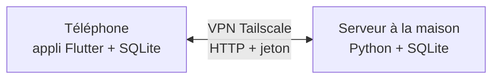

# My PDFs

Ma bibliothèque PDF sur Android, avec mon propre serveur à la maison. Je lis en faisant défiler vers le bas, je reprends là où je m'étais arrêté, et je surligne sans jamais modifier le fichier.

<!-- CAPTURES : supprimer cette ligne et la ligne « FIN CAPTURES » quand les images sont dans docs/captures/
<p align="center">
  
  
  
</p>
<p align="center">
  
  
  
</p>
FIN CAPTURES -->

## Pourquoi je l'ai fait

<!-- À TOI : ta dictée remplacera ce paragraphe. -->
J'ai beaucoup de livres en PDF, et le lecteur de mon téléphone tournait les pages une par une, sans rangement ni reprise de lecture. Je voulais une vraie bibliothèque, rangée par catégories, avec mes notes, et des livres stockés chez moi plutôt que chez un service en ligne.

## Ce que ça fait

- Lecture en défilement continu, reprise à la dernière page lue, mode nuit, plein écran, temps de lecture.
- Surlignage en 4 couleurs et notes par page, exportables en Markdown. Le PDF n'est jamais modifié.
- Catégories, filtres automatiques (en cours, pas commencés, terminés), tri et recherche par titre.
- Un serveur à la maison, avec 200 Go de place. Les livres qui y sont se lisent directement, sans les télécharger sur le téléphone.
- Recherche d'un mot dans le texte de tous les livres du serveur.
- Un carnet de lectures : livres lus, en cours ou à lire, avec une note et des statistiques.
- « Découvrir » : des livres libres de droits à ajouter en un appui (Internet Archive, Open Library, Gallica).

Tout le détail : [docs/FONCTIONNALITES.md](docs/FONCTIONNALITES.md).

## Comment c'est construit



- **L'appli** est en Flutter. L'affichage des PDF passe par pdfrx, et les notes, catégories et progressions sont dans une base SQLite.
- **Le serveur** est en Python (Starlette). Il stocke les livres, indexe leur texte pour la recherche (SQLite FTS5) et sauvegarde les données de lecture.
- **Chaque livre est identifié par l'empreinte SHA-256 de son fichier.** Si je renomme ou déplace un PDF, ses notes et sa progression le suivent.
- **La synchronisation se fait élément par élément** (page en cours, notes, catégories…). En cas de conflit, la modification la plus récente gagne.

## Ce qui m'a posé problème

<!-- À TOI : remplace ou complète avec ta version. -->
- **L'écran gris.** En version finale, ouvrir un livre donnait un écran gris, alors que tout marchait en mode développement. La cause : l'outil de recherche dans le livre était créé avant que le PDF soit chargé. Je l'ai corrigé, et l'appli affiche maintenant la vraie erreur au lieu d'un écran vide.
- **Lire sans remplir le téléphone.** Les livres du serveur se lisent par morceaux : seules les pages affichées sont transférées, grâce aux requêtes HTTP partielles.
- **Rester dans la loi.** « Découvrir » ne propose que des livres libres de droits. J'ai écarté les sources qui donnent accès à des livres protégés.

Limite connue : pas de reconnaissance de texte (OCR), donc le texte des pages scannées n'est ni copiable ni cherchable.

## Installer

Il faut une machine allumée en permanence pour le serveur, avec Tailscale, et Flutter sur le PC pour l'appli. En résumé :

```bash
cd my-pdfs/server && ./install.sh   # sur le serveur : affiche l'adresse et le jeton
cd my-pdfs && ./setup.sh && flutter run --release   # sur le PC, téléphone branché
```

Pas à pas et dépannage : [docs/INSTALLATION.md](docs/INSTALLATION.md). Fonctionnement interne : [docs/ARCHITECTURE.md](docs/ARCHITECTURE.md). Historique des versions : [CHANGELOG.md](CHANGELOG.md) (version actuelle : 0.7).
